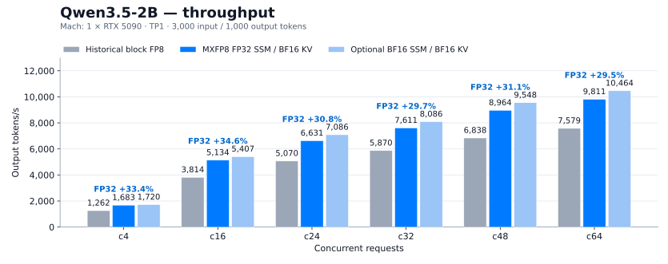
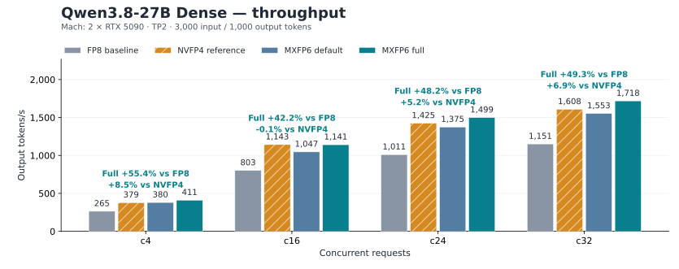
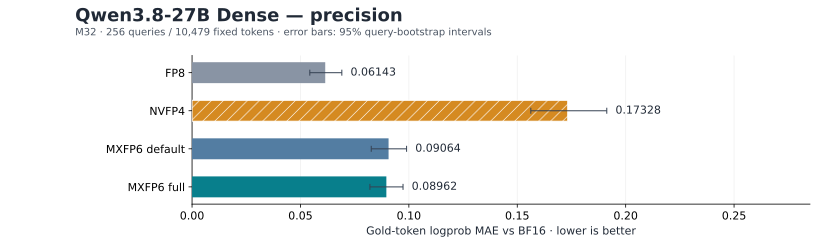
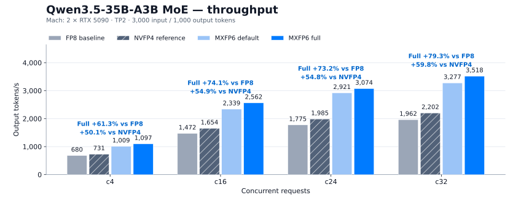
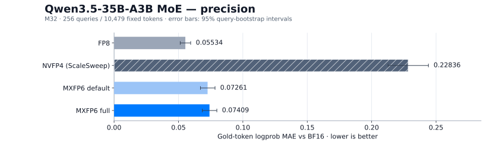

<p align="center">
  <picture>
    <source media="(prefers-color-scheme: dark)" srcset="docs/assets/mxfp6-wordmark-dark.png">
    
  </picture>
</p>

# Native MXFP6 and MXFP8 for NVIDIA SM120

`mxfp6-sm120` is a PyTorch CUDA kernel library for NVIDIA compute capability 12.0. MXFP6 W6A8 uses packed E3M2 weights; MXFP8 W8A8 uses E4M3 weights. Both consume E4M3 activations with one E8M0 power-of-two scale per 32 values and accumulate in FP32 on SM120 block-scaled Tensor Cores.

The package provides Dense GEMM, Qwen3.5 routed MoE, activation producers and CUDA Graph workspaces. [vLLM Mach](https://github.com/troycheng/vllm-mach) supplies checkpoint loading, model profiles and complete serving integration.

## Model serving performance

**3,000 input / 1,000 output tokens · output tokens/s · text-only, non-speculative inference.** End-to-end serving with [vLLM Mach](https://github.com/troycheng/vllm-mach) on one (TP1) or two (TP2) 32 GiB RTX 5090 GPUs.

| Model / profile | GPUs | Throughput gain vs FP8 | Details |
|---|---|---:|---|
| Qwen3.5-2B · MXFP8 · FP32 SSM / BF16 KV | 1 · TP1 | FP32 +29.46% to +34.60%; BF16 optional +36.34% to +41.74% | [Data](docs/performance.md#qwen35-2b) |
| Qwen3.5-4B · MXFP8 · FP32 SSM / FP8 KV | 1 · TP1 | FP32 +32.13% to +43.05%; BF16 optional +39.36% to +57.91% | [Data](docs/performance.md#qwen35-4b) |
| Qwen3.5-4B block-FP8 · Block-FP8 · all four features | 1 · TP1 | +5.97% to +9.03% | [Data](docs/performance.md#qwen35-4b-block-fp8) |
| Qwen3.8-27B Dense · MXFP6 default / full | 2 · TP2 | default +30.41% to +43.69%; full +42.18% to +55.40% | [Data](docs/performance.md#qwen38-27b) |
| Qwen3.5-35B-A3B MoE · MXFP6 default / full | 2 · TP2 | default +48.34% to +67.01%; full +61.34% to +79.32% | [Data](docs/performance.md#qwen35-35b-a3b) |

MXFP8 defaults to **FP32 SSM**, with **BF16 KV on 2B** and **FP8 KV on 4B**. The optional BF16 SSM curves use `--ssm-dtype bfloat16` with ordered GDN. The six greedy points are c4/16/24/32/48/64, measured on October 14 against historical block-FP8 references.

MXFP6 **default** uses FP32 recurrent state and the BF16 head; **full** adds FP16 state and NVFP4 candidate search with BF16 refinement. The launcher enables hybrid head by default; pass `--no-hybrid-head` to reproduce the measured historical default.

### Qwen3.5-2B · MXFP8



### Qwen3.5-4B · MXFP8


### Qwen3.8-27B Dense · FP8, NVFP4 and MXFP6





### Qwen3.5-35B-A3B MoE · FP8, NVFP4 and MXFP6





[Detailed service data and methodology](docs/performance.md) · [Machine-readable data](docs/data/model-performance.json)

The [October 15 random-sampling and best-path recheck](https://github.com/troycheng/vllm-mach/blob/main/docs/best-path-recheck-20261015.md) reports sampling gains separately from these greedy curves.

See [kernel benchmarks](docs/benchmarks.md) for GEMM and MoE operator timings, and the [Qwen3.8-27B study](docs/qwen38-27b.md) for memory capacity and precision results.

## Install

Requirements: Linux, SM120, Python 3.10+, CUDA Toolkit 12.8+, CUDA-enabled PyTorch with FP8 dtype support, CMake 3.24+ and a host compiler with C++20 support. Install PyTorch and Triton first, then build against the runtime PyTorch ABI:

```bash
git clone --recurse-submodules https://github.com/Nekofish-L/mxfp6_sm120.git
cd mxfp6_sm120
python3 -m pip install 'setuptools>=77' wheel
bash scripts/build_wheel.sh
python3 -m pip install --no-deps dist/mxfp6_sm120-*.whl
```

For an existing clone, run `git submodule update --init third_party/cutlass`. The wheel script applies the checked-in CUTLASS runtime patches and builds both extensions. `MAX_JOBS` defaults to 2. See [development and compatibility](docs/development.md) for ABI, build and upgrade policies.

Build from `main` to use the current producer and dual-activation APIs.

## Python API

Quantize weights once and reuse them for `x[M,K] @ weight[N,K].T`:

```python
import torch
import mxfp6
import mxfp6.mxfp8 as mxfp8

x = torch.randn((32, 2560), device="cuda", dtype=torch.bfloat16)
weight = torch.randn((4096, 2560), device="cuda", dtype=torch.bfloat16)
w6 = mxfp6.quantize_mxfp6(weight)
w8 = mxfp8.quantize_mxfp8(weight)
y6 = mxfp6.gemm(x, w6, out_dtype=torch.bfloat16)
y8 = mxfp8.gemm(x, w8)

# Quantize an activation explicitly for reuse with either format.
qa = mxfp6.quantize_activation(x)
y6 = mxfp6.gemm_w6a8(qa, w6, out_dtype=torch.bfloat16)
y8 = mxfp8.gemm_w8a8(qa, w8)
```

| Operator | Parameters | Guide |
|---|---|---|
| Dense W6A8 | Positive M/N/K; N multiple of 8, K multiple of 128; FP16/BF16 output | [Dense GEMM](docs/dense-gemm.md) |
| Dense W8A8 | Positive M; N/K multiples of 128; BF16 output, alpha=1 | [MXFP8](docs/mxfp8.md) |
| Dual W8A8 activation | Every M=1–128; N=12288 or 18432, K=2560; explicit opt-in | [Dual API](docs/mxfp8-dual.md) |
| Routed MoE | Qwen3.5-35B-A3B TP2 router, routed/shared experts and reduction | [MoE API](docs/qwen35-moe.md) |
| Activation producers | SwiGLU, GDN norm and attention gate with specified rounding/shape contracts | [Producer APIs](docs/producer-fusion.md) |

The [API guides](docs/README.md#operators) cover CUDA Graph setup, concurrent streams, buffer layout and workspace planning.

## Serving integration

Use [Mach's installation and launch guides](https://github.com/troycheng/vllm-mach) for current model profiles and dependency revisions. The library supplies operators and layouts; Mach owns model admission, scheduling and serving configuration.

The [vLLM v0.28 TP2 example](examples/vllm/README.md) is a separate version-locked reproducer for Qwen3.5-27B and Qwen3.5-35B-A3B. The example includes build, launch and native-execution checks.

## Documentation

| Entry | Contents |
|---|---|
| [Performance](docs/performance.md) | Model-size service comparison, absolute throughput, workloads and sources |
| [API guides](docs/README.md#operators) | Dense W6A8/W8A8, dual activations, MoE and producer contracts |
| [Checkpoint conversion](docs/quantize-checkpoints.md) | Validated Quark conversion, metadata checks and layout/ABI boundary |
| [Development](docs/development.md) | Platform, source build, ABI, integration and validation |
| [Benchmark evidence](docs/README.md#measurement-evidence) | Kernel measurements and fidelity studies |
| [Contributing](CONTRIBUTING.md) | Contribution and review requirements |

## License

[BSD 3-Clause](LICENSE). CUTLASS and other dependencies retain their own licenses.
