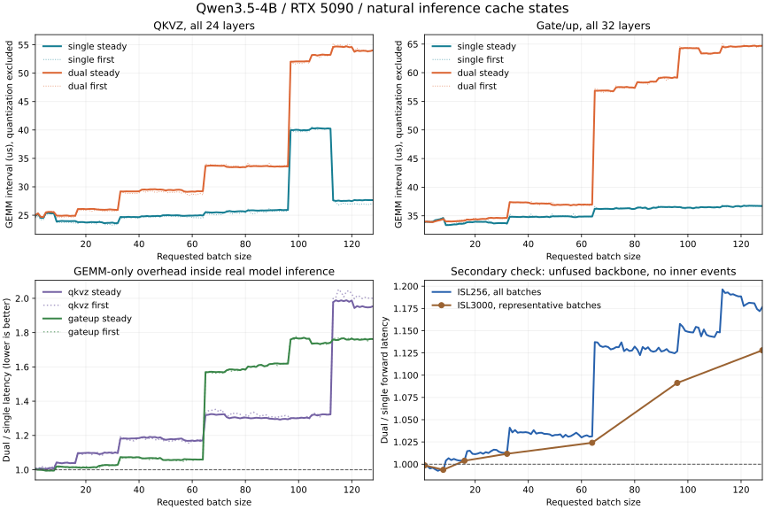
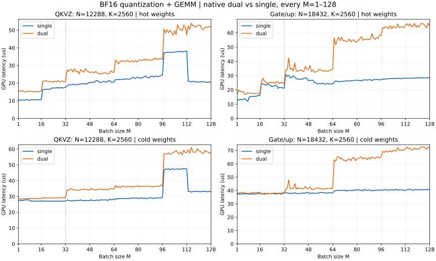
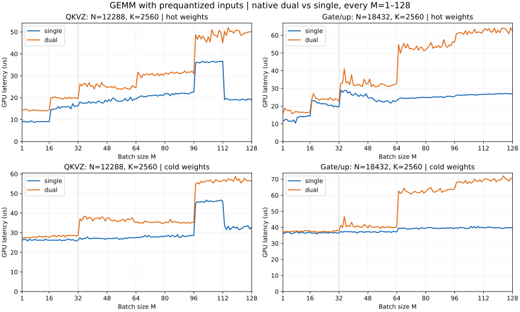

# Dual MXFP8 performance and fidelity

D/S is dual latency divided by single latency; values above 1 mean slower execution. These studies compare operators and backbone execution, not HTTP serving throughput. The [API guide](mxfp8-dual.md) defines the supported shapes and buffer contracts. Full per-batch tables remain in the linked CSV/JSON artifacts.

## Real-model activations and natural caches

测量日期：2026-10-09。模型：Qwen3.5-4B，BF16 转换的 MXFP8 checkpoint；RTX 5090，测试 GPU。

排除量化时间，真实推理稳态下 QKVZ 的 GEMM 延迟几何平均变化为 **+27.3%**，gate/up 为 **+31.8%**。作为次要交叉验证，当前未融合路径移除投影内部计时节点后的完整 backbone 前向为 **+8.2%**。这里正数表示 dual 更慢；dual 的价值应由精度需求评估，不能把双路累加当作已验证的加速方案。



## 实际冷热计算的定义

本次用 vLLM 的完整生成过程建立缓存状态：真实 embedding、32 层模型、GDN/attention、MLP、KV cache、部署端 LM head 和采样均实际执行。投影直接接收模型中产生的 BF16 激活。没有随机激活，没有反复只回放同一权重，没有清空 L2，也没有在同一个投影处先执行一组再执行另一组。

`first` 是所有请求完成 prefill 后的第一个完整 batch decode 步；`steady` 是随后连续 decode，去掉前 3 步和最后 2 步。二者保留实际的缓存状态，但不代表硬件 L2 的全冷/全热端点。本次没有测量 L2 命中率。模型各层的权重工作集远大于 96 MiB L2，连续 decode 也不能等同于单权重驻留 L2 的 hot microbenchmark。

## 对照与测量边界（主比较只计 GEMM）

- 按用户的激活函数+量化融合计划，主比较排除量化，只使用量化完成后的 GEMM 区间；本次没有实现这项融合，完整前向数字不代表未来融合后的部署收益。
- 保持 `qwen35-4b-mxfp8-champion-v1` 的 runtime 补丁、GDN、BA/QKVZ 并行、KV FP8、编译和 Graph 策略一致。依赖版本与 runtime 源码 SHA256 校验均通过。
- single 使用部署端 `mxfp8_e4m3_quantize` 加普通 native GEMM；dual 使用 high/residual 两路量化加当前仓库原生 dual GEMM。两边 PDL 均关闭。
- 测量 hook 将 32 个 gate/up 和 24 个 QKVZ 在 M=1–128 切到对应实验 arm。发布的 champion 默认仍是 gate/up M32、QKVZ M32/M64；本次验证的是扩展路径，不表示线上默认策略已变更。
- 投影时间来自 CUDA Graph 内的 external CUDA events，真实 replay 会更新时间戳。逐步核对全部 56 个投影以及实际 M。
- 投影数字是事件包围的算子区间，包含内部计时节点的影响，并非 CUPTI 提取的纯 kernel duration；无内部计时节点的完整前向用于检查是否存在明显的计时观察效应，融合后的最终前向仍需在融合实现上测量。
- 另起两组生命周期，移除全部投影内部事件，仅在完整 Graph replay 外计时，交叉验证完整 backbone 性能。该时间不包含 LM head、采样、CPU 调度或 HTTP；这些步骤仍照常执行并影响下一步缓存。
- ISL256 全测 128 个请求 batch，OSL32；每点正向/反向各一次。各重复内先取稳态步的中位数，再对两次重复求平均。投影时间先对该类所有层取平均。
- ISL3000 补测实际长对话，OSL384，使 chunked prefill 后仍有足够的完整 batch decode 步。使用 7 个代表 batch，正向/反向各一次。
- ISL256 使用 62 条足够长的实际对话截取前缀；ISL3000 使用数据集唯一一条 3000-token 对话，独立请求重复使用，prefix cache 关闭。两组使用相同提示和采样参数，但生成 token 可以因数值路径不同而变化。

## 部署 Graph 与原生 M 的关系

请求 BS=1–128 在部署 profile 下映射到 19 个实际 M：1、2、4、8、16、24、…、128。例如 BS3→M4、BS33→M40。这是部署端 Graph padding；dual 内核自身直接接收实际 M，未额外复制、拆分或补齐。当前 native API 对每个整数 M=1–128 的支持与此前正确性测试保留；真实部署测量应按下表的实际 M 解读。

single 使用仓库现有的按形状 tactic dispatch，dual 在 M32 之后切换 tile family。配置切换会造成曲线跃变，特别是 QKVZ 的请求 BS97–112 与 BS113–128；本轮没有重新调优 single 或 dual 的 dispatch。

## 首步与稳态汇总

| 阶段 | QKVZ GEMM D/S | gate/up GEMM D/S | 无内部事件 backbone D/S |
|---|---:|---:|---:|
| prefill 后首个完整 batch decode | 1.279 | 1.317 | 1.083 |
| 连续 decode 稳态 | 1.273 | 1.318 | 1.082 |

## 不同 batch 范围

| 请求 BS 范围 | 稳态 QKVZ D/S | 稳态 gate/up D/S | 无内部事件 backbone D/S |
|---|---:|---:|---:|
| 1-32 | 1.060 | 1.013 | 1.007 |
| 33-64 | 1.180 | 1.064 | 1.034 |
| 65-128 | 1.448 | 1.673 | 1.148 |

## 代表点：稳态、自然缓存

GEMM 为单个投影的全层平均微秒，排除量化；backbone 为移除投影计时节点后的完整前向毫秒。

| 请求 BS | 实际 M | QKVZ single/dual μs | gate/up single/dual μs | backbone single/dual ms | backbone D/S |
|---:|---:|---:|---:|---:|---:|
| 1 | 1 | 24.84/25.03 | 33.91/34.00 | 3.643/3.640 | 0.999 |
| 2 | 2 | 25.24/25.33 | 33.98/33.96 | 3.771/3.763 | 0.998 |
| 4 | 4 | 24.53/24.67 | 33.95/33.88 | 3.795/3.780 | 0.996 |
| 8 | 8 | 25.33/25.51 | 34.61/34.43 | 4.173/4.143 | 0.993 |
| 16 | 16 | 23.98/24.90 | 33.66/34.14 | 4.342/4.361 | 1.004 |
| 24 | 24 | 23.75/26.03 | 33.96/34.44 | 4.525/4.587 | 1.014 |
| 32 | 32 | 23.63/25.93 | 33.67/34.65 | 4.796/4.862 | 1.014 |
| 40 | 40 | 24.66/29.21 | 34.77/37.31 | 5.277/5.465 | 1.035 |
| 48 | 48 | 24.83/29.53 | 34.76/37.14 | 5.621/5.810 | 1.034 |
| 64 | 64 | 24.94/29.23 | 34.87/36.96 | 6.133/6.325 | 1.031 |
| 80 | 80 | 25.64/33.45 | 36.21/57.34 | 6.980/7.902 | 1.132 |
| 96 | 96 | 25.93/33.56 | 36.52/59.12 | 7.652/8.623 | 1.127 |
| 112 | 112 | 40.24/53.23 | 36.46/63.47 | 8.562/9.830 | 1.148 |
| 128 | 128 | 27.65/54.03 | 36.71/64.69 | 8.963/10.544 | 1.176 |

## 3000-token 上下文：完整前向交叉验证

| 请求 BS | 实际 M | first single/dual ms | first D/S | steady single/dual ms | steady D/S |
|---:|---:|---:|---:|---:|---:|
| 1 | 1 | 3.692/3.688 | 0.999 | 3.653/3.648 | 0.999 |
| 8 | 8 | 4.389/4.345 | 0.990 | 4.364/4.336 | 0.994 |
| 16 | 16 | 4.727/4.730 | 1.001 | 4.776/4.795 | 1.004 |
| 32 | 32 | 5.566/5.637 | 1.013 | 5.692/5.758 | 1.012 |
| 64 | 64 | 7.705/7.898 | 1.025 | 7.894/8.084 | 1.024 |
| 96 | 96 | 10.174/11.129 | 1.094 | 10.412/11.363 | 1.091 |
| 128 | 128 | 12.360/13.986 | 1.132 | 12.638/14.256 | 1.128 |

## 证据和复现

- [全部延迟 CSV](../benchmarks/results/mxfp8_dual_actual_inference_bs1_128.csv)、[结果和环境 JSON](../benchmarks/results/mxfp8_dual_actual_inference_bs1_128.json)、[曲线](mxfp8-dual-actual-inference.svg)。
- native 实现：`mxfp6_sm120/python/mxfp6/mxfp8_dual.py`；完整推理 harness：`benchmarks/benchmark_mxfp8_dual_inference.py`；覆盖检查和汇总：`benchmarks/report_mxfp8_dual_inference.py`。
- 本机原始逐步/逐层数据、生成 token、部署 worker receipt、runtime 源码校验、隔离环境身份均在 `${AUDIT_ROOT}/`。有效运行目录：`single-v2`、`dual`、`dual-forward`、`single-forward`。
- 从 vllm0.29.0 和 b12x1.2.6 wheel 解压到独立 site，复制 main06a08a3 的 `vllm_mach`，使用 `mxfp8.install.install_profile` 应用已校验 runtime 补丁。未改全局 vLLM 或正在运行的服务。
- 隔离 profile 的 `install_worker_hook` 调用测量脚本的 `install_measurement()`，再执行原 profile hook，最后 `wrap_worker()`。单独启动进程，设置 `MX8_INFERENCE_ARM=single/dual`；完整前向验证设置 `MX8_INFERENCE_EVENTS=0`。
- 所有运行使用同一测试 GPU；未锁频。每组内部采用相反 batch 顺序复测。数据是该模型、GPU、runtime 和提示集合的测量，不是跨模型或整服务吞吐结论。
- 之前人工 hot/evicted cold 的报告仅解释内核端点；部署结论以本报告的自然缓存结果为准。

隔离环境准备完成后，以同一 GPU 分别运行两个 arm：

```bash
CUDA_VISIBLE_DEVICES="${GPU_ID}" \
MXFP8_LIBRARY_PATH="${KERNEL_ROOT}/build/mxfp8/mxfp8_torch.so" \
PYTHONPATH="${AUDIT_ROOT}/site:${KERNEL_ROOT}/python:${KERNEL_ROOT}/benchmarks" \
"${RUNTIME_PYTHON}" \
  benchmarks/benchmark_mxfp8_dual_inference.py --arm single \
  --model "${MODEL_DIR}" --prompts "${PROMPTS_FILE}" \
  --output "${AUDIT_ROOT}/new-single" \
  --repeats 2 --output-tokens 32
```

将 `--arm single` 改为 `dual` 并使用不同输出目录即可测另一组。完整前向验证添加环境变量 `MX8_INFERENCE_EVENTS=0` 和参数 `--extra-context 3000`。

复现命令中的变量按本地环境设置：`KERNEL_ROOT` 为内核仓库，`RUNTIME_ROOT` 为对应 runtime 源码，`RUNTIME_PYTHON` 为其 Python 环境，`MODEL_DIR` 为模型目录，`AUDIT_ROOT` 为本地审计目录，`PROMPTS_FILE` 为提示 JSON，`GPU_ID` 为测试设备编号。公开报告不包含原始提示、生成内容或私有权重；路径和设备标识已脱敏，内容哈希对应原始测量文件。

## Synthetic activations: hot and evicted caches

dual 的主要收益是更小的激活量化误差。本轮没有证明它能提升算子吞吐；hot weights下通常比single慢，cold weights下小batch的gate/up接近single，大batch额外开销明显。下表为全部128个bs的 D/S 时延比几何均值。**D/S>1 表示dual更慢，1.20表示时延增加20%**。

| 投影 | 纯GEMM hot D/S | 纯GEMM cold D/S | 量化+GEMM hot D/S | 量化+GEMM cold D/S |
|---|---:|---:|---:|---:|
| QKVZ | 1.507× | 1.276× | 1.462× | 1.250× |
| gate/up | 1.684× | 1.326× | 1.643× | 1.326× |

| 投影 | single relative L2 | dual relative L2 | 误差改善倍数 |
|---|---:|---:|---:|
| QKVZ | 2.670% | 0.166% | 16.10× |
| gate/up | 2.669% | 0.166% | 16.10× |

误差为128个bs的中位数。参考是BF16输入对应的FP32 GEMM，使用同一份反量化MXFP8权重，TF32关闭；衡量激活近似和BF16输出舍入，不包含原始BF16权重转MXFP8的误差。

## 性能曲线

量化+GEMM：



纯GEMM：



32处虚线标记dual kernel family切换；single使用现有M区间dispatch，曲线不必随bs单调变化。

## 测量和验证范围

RTX5090（96MiB L2）、driver595.71.05、CUDA13.0.88、PyTorch2.13.0+cu130。权重来自Qwen3.5-4B第1层，激活为固定种子的合成BF16正态输入。single使用当前原生dispatch，PDL关闭；dual也使用普通启动，两者输入、权重、输出dtype相同。

hot：每个Graph含16次调用，每轮20次replay；cold：Graph含1次调用，每次计时前用256MiB buffer驱逐L2，每轮5次replay，驱逐不计入时延。两种口径都做9轮随机顺序paired试验，CUDA Event测整个调用GPU时间。single量化+GEMM使用已规划/冻结workspace，纯GEMM用prepare分配私有workspace；dual无需GEMM workspace。CPU分配、Python dispatch、编译和服务调度不计入时延。

869项原生测试通过，其中385项dual测试覆盖全部batch；19项memcheck零错误。扩展前的三种原始形状做12组changing-input Graph对照，输出和limb/scale逐字节一致。全部256个性能点另做4次变化输入/poisoned buffer回放，Graph与eager逐位一致。

未锁GPU时钟，接近零的额外时延应视为基本持平。只扩展M，N/K仍限定上述形状；静态tile不代表对每个bs都全局最优。单个层和合成激活的结果也不能代表所有模型。

## 数据与复现

- [全部256点CSV](../benchmarks/results/mxfp8_dual_bs1_128.csv)
- [原始样本和环境JSON](../benchmarks/results/mxfp8_dual_bs1_128.json)
- [benchmark脚本](../benchmarks/benchmark_mxfp8_dual.py)
- [原生dual API文档](mxfp8-dual.md)

```bash
cd "${KERNEL_ROOT}"
CUDA_VISIBLE_DEVICES="${GPU_ID}" PYTHONPATH=python python3 benchmarks/benchmark_mxfp8_dual.py \
  --checkpoint "${MODEL_DIR}/model.safetensors" \
  --output /tmp/dual-single-bs1-128-recheck
```

复现命令中的变量按本地环境设置：`KERNEL_ROOT` 为内核仓库，`RUNTIME_ROOT` 为对应 runtime 源码，`RUNTIME_PYTHON` 为其 Python 环境，`MODEL_DIR` 为模型目录，`AUDIT_ROOT` 为本地审计目录，`PROMPTS_FILE` 为提示 JSON，`GPU_ID` 为测试设备编号。公开报告不包含原始提示、生成内容或私有权重；路径和设备标识已脱敏，内容哈希对应原始测量文件。
