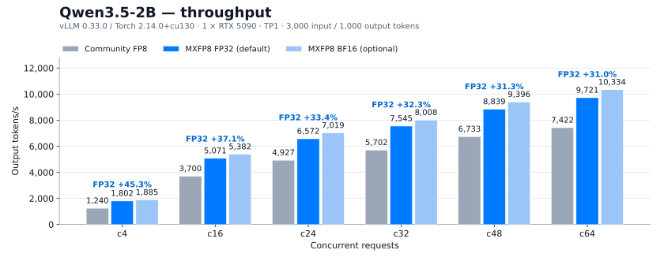
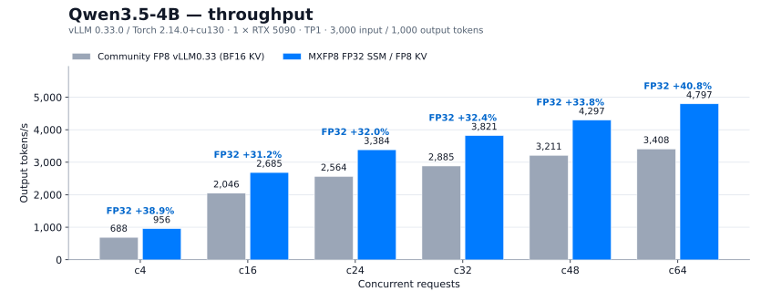
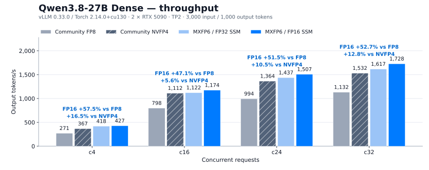
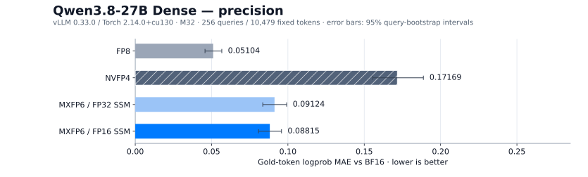
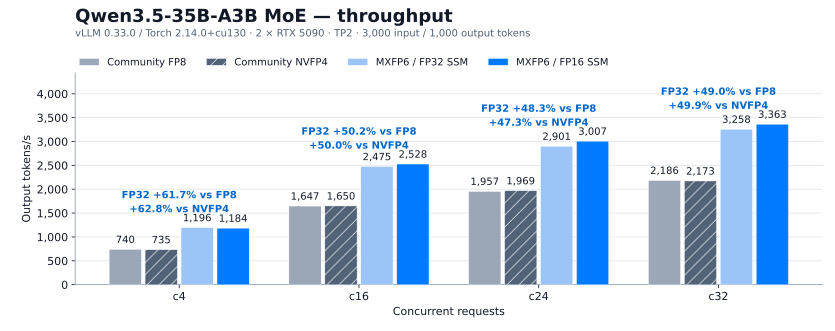

# Model serving performance

vLLM 0.33.0 / Torch 2.14.0+cu130

RTX 5090 · 3,000 input / 1,000 output tokens · output tokens/s.

## Qwen3.5-2B

MXFP8 / FP32 SSM default; BF16 SSM optional / BF16 KV / headgraph ON · TP1 · November 2026

| Concurrency | Community FP8 | MXFP8 FP32 (default) | MXFP8 BF16 (optional) |
|---|---:|---:|---:|
| c4 | 1240.06 | 1801.76 | 1884.69 |
| c16 | 3699.70 | 5070.80 | 5381.75 |
| c24 | 4926.73 | 6571.65 | 7018.89 |
| c32 | 5702.37 | 7544.90 | 8007.86 |
| c48 | 6732.99 | 8839.02 | 9395.60 |
| c64 | 7422.14 | 9721.13 | 10334.42 |

[Published aggregate evidence](data/evidence-vllm033/two_b_fp32_default_composite.json)

## Qwen3.5-4B

MXFP8 FP32 SSM / FP8 KV / hybrid head · TP1 · November 2026

| Concurrency | Community FP8 vLLM0.33 (BF16 KV) | MXFP8 FP32 SSM / FP8 KV |
|---|---:|---:|
| c4 | 688.28 | 956.35 |
| c16 | 2046.41 | 2684.51 |
| c24 | 2564.47 | 3384.25 |
| c32 | 2884.61 | 3820.60 |
| c48 | 3211.34 | 4297.35 |
| c64 | 3407.87 | 4796.72 |

[Published aggregate evidence](data/evidence-vllm033/four_fp32.json)

## Qwen3.8-27B Dense

MXFP6 / FP32 SSM or FP16 FULL / BF16 KV / head ON · TP2 · November 2026

| Concurrency | Community FP8 | Community NVFP4 | MXFP6 / FP32 SSM | MXFP6 / FP16 SSM |
|---|---:|---:|---:|---:|
| c4 | 271.47 | 366.88 | 418.37 | 427.43 |
| c16 | 798.18 | 1111.68 | 1121.78 | 1173.98 |
| c24 | 994.24 | 1363.64 | 1437.43 | 1506.69 |
| c32 | 1131.81 | 1531.52 | 1617.25 | 1727.78 |

[Published aggregate evidence](data/evidence-vllm033/dense_full.json)

## Qwen3.5-35B-A3B MoE

MXFP6 / FP32 SSM / BF16 KV / head ON / headgraph OFF · TP2 · November 2026

| Concurrency | Community FP8 | Community NVFP4 | MXFP6 / FP32 SSM | MXFP6 / FP16 SSM |
|---|---:|---:|---:|---:|
| c4 | 739.69 | 734.55 | 1196.01 | 1183.92 |
| c16 | 1647.34 | 1650.08 | 2474.88 | 2527.74 |
| c24 | 1956.68 | 1969.03 | 2901.03 | 3007.23 |
| c32 | 2186.13 | 2172.68 | 3257.79 | 3362.91 |

Selected FP32 SSM is unchanged. FP16 FULL uses the accepted [four-point serving aggregate](data/evidence-vllm033/moe_full_final.json).

[Published aggregate evidence](data/evidence-vllm033/moe_current.json)

[Normalized data](data/model-performance-vllm033.json) · [Aggregation and precision protocol](data/evidence-vllm033/README.md)

## Block-FP8 migration status

Block-FP8 preserves c32 throughput (−0.13%) and improves c64 by 0.90% versus vLLM 0.29. The comparison covers 2,400 requests across 10 measurement windows.

## Other measured configurations

MoE FP16 FULL preserves throughput at c4 and c16, and improves c24 by 2.93% and c32 by 1.79% versus vLLM 0.29. 4B MXFP8 with BF16 state improves at c24 and c32. The retained 2B FP32 configuration with headgraph OFF preserves c16 throughput.

[Measured migration results](data/evidence-vllm033/migration-status.json)
