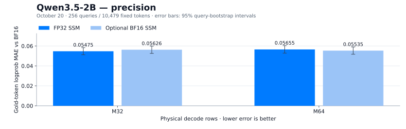
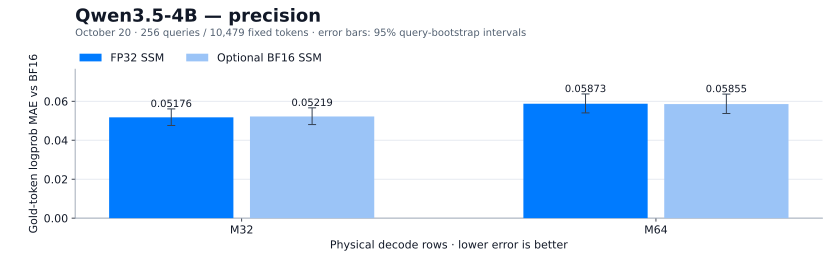
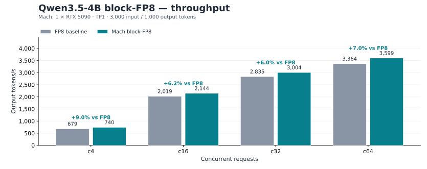

# Model serving performance

Measured complete configurations on RTX 5090: **3,000 input / 1,000 output tokens**, text-only, non-speculative inference. Throughput is **output tokens/s**; `c` is concurrent requests, and physical kernel rows are denoted `M`.

Each model has its own throughput chart. The 27B Dense and 35B-A3B MoE comparisons include FP8, NVFP4 and both MXFP6 profiles, followed by a separate precision chart against BF16.

MXFP6 **default** retains FP32 recurrent state and the BF16 head. **Full** adds FP16 state and NVFP4 candidate search with BF16 refinement. MXFP8 uses FP32 SSM by default: BF16 KV on 2B and FP8 KV on 4B. BF16 SSM is an optional configuration.

<a id="qwen35-2b"></a>
## Qwen3.5-2B — MXFP8 · FP32 SSM / BF16 KV

Mach profile: 2026-10-14 · 1 × RTX 5090 · TP1


| Concurrency | Historical block FP8 | MXFP8 FP32 SSM | vs block FP8 | Optional BF16 SSM | vs block FP8 | BF16 vs FP32 |
|---|---:|---:|---:|---:|---:|---:|
| c4 | 1261.89 | 1682.89 | +33.36% | 1720.48 | +36.34% | +2.23% |
| c16 | 3814.33 | 5134.27 | +34.60% | 5406.61 | +41.74% | +5.30% |
| c24 | 5069.68 | 6631.15 | +30.80% | 7086.18 | +39.78% | +6.86% |
| c32 | 5870.22 | 7610.93 | +29.65% | 8086.39 | +37.75% | +6.25% |
| c48 | 6837.60 | 8963.55 | +31.09% | 9547.91 | +39.64% | +6.52% |
| c64 | 7578.86 | 9811.23 | +29.46% | 10463.62 | +38.06% | +6.65% |

Both MXFP8 curves use BF16 KV and ordered GDN. FP32 SSM is the launcher default; add `--ssm-dtype bfloat16` for the optional curve. Block-FP8 rates are historical references; MXFP8 curves are the October 14 greedy configuration sweep. These ratios compare complete configurations.

[October 15 random-sampling and best-path recheck](https://github.com/troycheng/vllm-mach/blob/main/docs/best-path-recheck-20261015.md) uses a separate sampling workload.

### Qwen3.5-2B precision



| Physical rows | FP32 SSM MAE [95% CI] | Optional BF16 SSM MAE [95% CI] | BF16 vs FP32 |
|---|---:|---:|---:|
| M32 | 0.05475 [0.05121, 0.05841] | 0.05626 [0.05257, 0.05993] | +2.75% |
| M64 | 0.05655 [0.05284, 0.06042] | 0.05535 [0.05172, 0.05903] | -2.12% |

October 20 · 256 queries / 10,479 fixed gold tokens per configuration · query-mean logprob MAE against BF16. Lower is better; intervals use 20,000 query-bootstrap samples. Frozen BF16 M32 anchor at both shapes. All first-cohort repeats were identical.

[Precision data](https://github.com/troycheng/vllm-mach/blob/main/docs/data/mxfp8-fidelity-20261020.json) · [Raw logprobs and receipts](https://github.com/troycheng/vllm-mach/blob/main/docs/data/mxfp8-fidelity-20261020-records.json.gz) · [Configuration and reproduction](https://github.com/troycheng/vllm-mach/blob/main/docs/mxfp8-2b-champion.md)

[Profile / study](https://github.com/troycheng/vllm-mach/blob/main/docs/mxfp8-2b-champion.md) · [Source measurements](https://github.com/troycheng/vllm-mach/blob/main/docs/data/mxfp8-benchmark.json)

<a id="qwen35-4b"></a>
## Qwen3.5-4B — MXFP8 · FP32 SSM / FP8 KV

Mach profile: 2026-10-14 · 1 × RTX 5090 · TP1


| Concurrency | Historical block FP8 | MXFP8 FP32 SSM | vs block FP8 | Optional BF16 SSM | vs block FP8 | BF16 vs FP32 |
|---|---:|---:|---:|---:|---:|---:|
| c4 | 683.96 | 957.38 | +39.98% | 980.42 | +43.34% | +2.41% |
| c16 | 2053.55 | 2713.33 | +32.13% | 2861.86 | +39.36% | +5.47% |
| c24 | 2559.26 | 3432.69 | +34.13% | 3668.42 | +43.34% | +6.87% |
| c32 | 2887.82 | 3889.65 | +34.69% | 4179.18 | +44.72% | +7.44% |
| c48 | 3220.55 | 4396.73 | +36.52% | 4777.60 | +48.35% | +8.66% |
| c64 | 3402.76 | 4867.51 | +43.05% | 5373.24 | +57.91% | +10.39% |

Both MXFP8 curves use FP8 KV and ordered GDN. FP32 SSM is the launcher default; add `--ssm-dtype bfloat16` for the optional curve. Block-FP8 rates are historical references; MXFP8 curves are the October 14 greedy configuration sweep. These ratios compare complete configurations.

[October 15 random-sampling and best-path recheck](https://github.com/troycheng/vllm-mach/blob/main/docs/best-path-recheck-20261015.md) uses a separate sampling workload.

### Qwen3.5-4B precision



| Physical rows | FP32 SSM MAE [95% CI] | Optional BF16 SSM MAE [95% CI] | BF16 vs FP32 |
|---|---:|---:|---:|
| M32 | 0.05176 [0.04757, 0.05608] | 0.05219 [0.04805, 0.05662] | +0.84% |
| M64 | 0.05873 [0.05404, 0.06374] | 0.05855 [0.05372, 0.06369] | -0.30% |

October 20 · 256 queries / 10,479 fixed gold tokens per configuration · query-mean logprob MAE against BF16. Lower is better; intervals use 20,000 query-bootstrap samples. Frozen BF16 anchor at each matching physical shape. All first-cohort repeats were identical.

[Precision data](https://github.com/troycheng/vllm-mach/blob/main/docs/data/mxfp8-fidelity-20261020.json) · [Raw logprobs and receipts](https://github.com/troycheng/vllm-mach/blob/main/docs/data/mxfp8-fidelity-20261020-records.json.gz) · [Configuration and reproduction](https://github.com/troycheng/vllm-mach/blob/main/docs/mxfp8-champion.md)

[Profile / study](https://github.com/troycheng/vllm-mach/blob/main/docs/mxfp8-champion.md) · [Source measurements](https://github.com/troycheng/vllm-mach/blob/main/docs/data/mxfp8-benchmark.json)

<a id="qwen38-27b"></a>
## Qwen3.8-27B Dense — MXFP6 default / full

Mach profile: 2026-09-20 · 2 × RTX 5090 · TP2


| Concurrency | FP8 | NVFP4 | MXFP6 default | MXFP6 full |
|---|---:|---:|---:|---:|
| c4 | 264.57 | 378.97 | 380.17 | 411.14 |
| c16 | 802.79 | 1142.87 | 1046.93 | 1141.40 |
| c24 | 1011.43 | 1424.61 | 1374.53 | 1498.93 |
| c32 | 1150.97 | 1607.56 | 1553.09 | 1718.24 |

| Concurrency | Default vs FP8 | Full vs FP8 | Default vs NVFP4 | Full vs NVFP4 |
|---|---:|---:|---:|---:|
| c4 | +43.69% | +55.40% | +0.32% | +8.49% |
| c16 | +30.41% | +42.18% | -8.39% | -0.13% |
| c24 | +35.90% | +48.20% | -3.52% | +5.22% |
| c32 | +34.94% | +49.29% | -3.39% | +6.89% |

### Qwen3.8-27B Dense precision


| FP8 MAE | NVFP4 MAE | MXFP6 default MAE | MXFP6 full MAE |
|---:|---:|---:|---:|
| 0.06143 | 0.17328 | 0.09064 | 0.08962 |

M32 · 256 queries / 10,479 fixed gold tokens · query-mean logprob MAE against BF16. Lower is better. Error bars show 95% query-bootstrap intervals.

[NVFP4 throughput (2026-09-15)](https://github.com/troycheng/vllm-mach/blob/eaa0acd6f5700913d10a422f6d4075614b9fb6be/docs/data/native-serving.json) · [Precision measurements](https://github.com/troycheng/vllm-mach/blob/eaa0acd6f5700913d10a422f6d4075614b9fb6be/docs/data/profile-fidelity-20260917.json)

[Profile / study](https://github.com/troycheng/vllm-mach/blob/main/docs/dense-gains-aligned-baseline-20260920.md) · [Source measurements](https://github.com/troycheng/vllm-mach/blob/eaa0acd6f5700913d10a422f6d4075614b9fb6be/docs/data/dense-gains-aligned-baseline-20260920.json)

<a id="qwen35-35b-a3b"></a>
## Qwen3.5-35B-A3B MoE — MXFP6 default / full

Mach profile: 2026-09-28 · 2 × RTX 5090 · TP2


| Concurrency | FP8 | NVFP4 | MXFP6 default | MXFP6 full |
|---|---:|---:|---:|---:|
| c4 | 679.89 | 730.60 | 1008.56 | 1096.93 |
| c16 | 1471.58 | 1654.20 | 2338.97 | 2561.85 |
| c24 | 1774.64 | 1985.31 | 2920.74 | 3073.56 |
| c32 | 1962.14 | 2202.11 | 3277.02 | 3518.44 |

| Concurrency | Default vs FP8 | Full vs FP8 | Default vs NVFP4 | Full vs NVFP4 |
|---|---:|---:|---:|---:|
| c4 | +48.34% | +61.34% | +38.05% | +50.14% |
| c16 | +58.94% | +74.09% | +41.40% | +54.87% |
| c24 | +64.58% | +73.19% | +47.12% | +54.82% |
| c32 | +67.01% | +79.32% | +48.81% | +59.78% |

### Qwen3.5-35B-A3B MoE precision


| FP8 MAE | NVFP4 MAE | MXFP6 default MAE | MXFP6 full MAE |
|---:|---:|---:|---:|
| 0.05534 | 0.22836 | 0.07261 | 0.07409 |

M32 · 256 queries / 10,479 fixed gold tokens · query-mean logprob MAE against BF16. Lower is better. Error bars show 95% query-bootstrap intervals.

[NVFP4 throughput (2026-09-17)](https://github.com/troycheng/vllm-mach/blob/eaa0acd6f5700913d10a422f6d4075614b9fb6be/docs/data/qwen35-default-full-20260917.json) · [Precision measurements](https://github.com/troycheng/vllm-mach/blob/eaa0acd6f5700913d10a422f6d4075614b9fb6be/docs/data/profile-fidelity-20260917.json)

[Profile / study](https://github.com/troycheng/vllm-mach/blob/main/docs/moe-gains-fp8-baseline-20260920.md) · [Source measurements](https://github.com/troycheng/vllm-mach/blob/eaa0acd6f5700913d10a422f6d4075614b9fb6be/docs/data/moe-recheck-20260928.json)

<a id="qwen35-4b-block-fp8"></a>
## Qwen3.5-4B block-FP8 — Block-FP8 · all four features

Mach profile: 2026-10-06 · 1 × RTX 5090 · TP1



| Concurrency | FP8 baseline | Selected profile | Gain |
|---|---:|---:|---:|
| c4 | 678.54 | 739.84 | +9.03% |
| c16 | 2018.89 | 2143.60 | +6.18% |
| c32 | 2834.84 | 3004.00 | +5.97% |
| c64 | 3363.73 | 3598.84 | +6.99% |

| Concurrency | Selected mean TTFT (ms) | Selected mean TPOT (ms) |
|---|---:|---:|
| c4 | 192.46 | 5.218 |
| c16 | 260.16 | 7.205 |
| c32 | 451.17 | 10.182 |
| c64 | 771.87 | 16.955 |

[Profile / study](https://github.com/troycheng/vllm-mach/blob/main/docs/fp8-profile.md) · [Source measurements](https://github.com/troycheng/vllm-mach/blob/eaa0acd6f5700913d10a422f6d4075614b9fb6be/docs/data/fp8-qualification-20261006.json)

## Numerical fidelity

The September 17 MXFP6 evaluation measures token-logprob MAE against BF16 using 256 queries / 10,479 tokens. Lower MAE means closer numerical agreement with BF16.

| Profile | Physical rows | Numerical result |
|---|---|---|
| 2B / 4B MXFP8 | M32/M64 | October 20: eight current-runtime configurations, with FP32 and BF16 SSM reported separately above. |
| 4B block-FP8 | M4/32/64 | Fixed-gold records byte-identical to stock block-FP8. |
| 27B Dense MXFP6 default / full | M32 | BF16 MAE 0.09064 / 0.08962; FP8 0.06143, NVFP4 0.17328. |
| 35B-A3B MoE MXFP6 default / full | M32 | BF16 MAE 0.07261 / 0.07409; FP8 0.05534, NVFP4 0.22836. |

[2B precision and generation coverage](https://github.com/troycheng/vllm-mach/blob/main/docs/mxfp8-2b-champion.md#precision) · [4B qualification](https://github.com/troycheng/vllm-mach/blob/main/docs/mxfp8-champion.md#validation) · [MXFP6 fidelity methodology](https://github.com/troycheng/vllm-mach/blob/main/docs/profile-fidelity-20260917.md)

### Measurement protocol

The linked studies and [source records](data/model-performance.json) retain hardware identities, software revisions, request counts and baseline dates. MXFP8 precision uses Mach `afcb4cf` and native `ce0cd05`; MXFP6 precision uses the September 17 evaluation. Logprob checks use the complete head: BF16 for MXFP6/2B, and the existing NVFP4 head with K2048 BF16 score refinement for 4B. The [frozen token manifest](https://github.com/troycheng/vllm-mach/blob/main/docs/data/fidelity-samples.json) is public. Hybrid candidate selection has separate generation checks in the profile guides.

The 27B NVFP4 throughput reference is the September 15 token-ID sweep. The 35B-A3B NVFP4 throughput reference is the September 17 user service; its launch configuration was not recorded. The separate 35B-A3B precision evaluation used the NVFP4 ScaleSweep checkpoint. Source records preserve these identities and measurement dates.

### Reproduce MXFP8 fidelity

Run from a vLLM Mach checkout inside the pinned MXFP8 environment with a prepared checkpoint:

```bash
CUDA_VISIBLE_DEVICES=0 python tools/measure_mxfp8_fidelity.py \
  --profile 2b --model /models/PREPARED-2B --rows 32 \
  --ssm-dtype float32 --outdir /results/2b-m32-fp32
```

Use `--profile 4b` for the prepared 4B model. Run each M32/M64 × float32/bfloat16 combination in a separate process and fresh output directory. The tool saves raw gold logprobs, model/library identities, runtime receipts and repeat differences. The published compressed record bundle includes the BF16 anchors. For each query, average the absolute logprob differences over its gold tokens, then average those 256 query errors.

[Validation tool](https://github.com/troycheng/vllm-mach/blob/main/tools/measure_mxfp8_fidelity.py) · [Results and raw-record bundle](https://github.com/troycheng/vllm-mach/blob/main/docs/data/mxfp8-fidelity-20261020.json)

## Data and regeneration

The [normalized data](data/model-performance.json) record source revisions, SHA-256 hashes, unrounded throughputs and per-point ratios. Gain is `100 × (selected / baseline − 1)`.

These figures are generated by [vLLM Mach's renderer](https://github.com/troycheng/vllm-mach/blob/main/tools/render_performance_docs.py). The native-only kernel and earlier service studies remain in [benchmarks](benchmarks.md).
