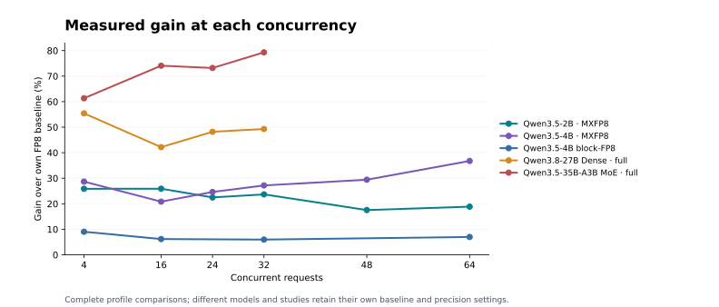

# Model serving performance

Measured complete configurations on RTX 5090: **3,000 input / 1,000 output tokens**, text-only, non-speculative inference. Throughput is **output tokens/s**; `c` is concurrent requests, and physical kernel rows are denoted `M`.

The 2B/4B MXFP8 and 27B/35B MXFP6 paths combine native operators with vLLM Mach. Block-FP8 is a separate Mach path. Each model keeps its own measured FP8 baseline; the tables below state the comparison date and scope.

MXFP6 **default** retains FP32 recurrent state and the BF16 head. **Full** adds FP16 state and NVFP4 candidate search with BF16 refinement. The 2B MXFP8 champion uses BF16 KV and K128 hybrid head at M≤32; 4B uses calibrated FP8 KV and its own refined head.

## Qwen3.5-2B — MXFP8 · Triton + hybrid

2026-10-11 · 1 × RTX 5090 · TP1. Selected and previous configurations are paired on GPU0; community FP8 is the historical GPU1 reference.

| Concurrency | Community FP8 | Previous FA2/full-head | Current Triton + hybrid | vs FP8 | vs previous |
|---|---:|---:|---:|---:|---:|
| c4 | 1261.89 | 1395.31 | 1588.27 | +25.86% | +13.83% |
| c16 | 3814.33 | 4295.10 | 4801.96 | +25.89% | +11.80% |
| c24 | 5069.68 | 5594.33 | 6209.52 | +22.48% | +11.00% |
| c32 | 5870.22 | 6595.49 | 7259.99 | +23.67% | +10.08% |
| c48 | 6837.60 | 7896.46 | 8036.47 | +17.53% | +1.77% |
| c64 | 7578.86 | 8702.23 | 9008.34 | +18.86% | +3.52% |

| Concurrency | Selected mean TTFT (ms) | Selected mean TPOT (ms) |
|---|---:|---:|
| c4 | 98.90 | 2.421 |
| c16 | 134.09 | 3.198 |
| c24 | 192.81 | 3.666 |
| c32 | 224.49 | 4.174 |
| c48 | 277.45 | 5.678 |
| c64 | 333.26 | 6.743 |

[Profile / study](https://github.com/troycheng/vllm-mach/blob/main/docs/mxfp8-2b-champion.md) · [Source measurements](https://github.com/troycheng/vllm-mach/blob/eaa0acd6f5700913d10a422f6d4075614b9fb6be/docs/data/mxfp8-2b-triton-hybrid-sixpoint-20261011.json)

A later same-runtime c32 observation was 7,216.58 tok/s, paired with FA2 + hybrid at 7,210.06 tok/s. It remains a separate comparison.

## Qwen3.5-4B — MXFP8 champion

2026-10-06 · 1 × RTX 5090 · TP1. One complete source-built champion screen versus the October 5 community FP8 screen; 1,040 requests per screen.

| Concurrency | FP8 baseline | Selected profile | Gain |
|---|---:|---:|---:|
| c4 | 683.96 | 880.13 | +28.68% |
| c16 | 2053.55 | 2481.30 | +20.83% |
| c24 | 2559.26 | 3189.42 | +24.62% |
| c32 | 2887.82 | 3672.70 | +27.18% |
| c48 | 3220.55 | 4168.04 | +29.42% |
| c64 | 3402.76 | 4653.93 | +36.77% |

| Concurrency | Selected mean TTFT (ms) | Selected mean TPOT (ms) |
|---|---:|---:|
| c4 | 173.56 | 4.375 |
| c16 | 237.62 | 6.211 |
| c24 | 347.70 | 7.167 |
| c32 | 410.70 | 8.286 |
| c48 | 540.36 | 10.947 |
| c64 | 688.76 | 13.017 |

[Profile / study](https://github.com/troycheng/vllm-mach/blob/main/docs/mxfp8-champion.md) · [Source measurements](https://github.com/troycheng/vllm-mach/blob/eaa0acd6f5700913d10a422f6d4075614b9fb6be/docs/data/mxfp8-qualification-20261006.json)

## Qwen3.5-4B block-FP8 — Block-FP8 · all four features

2026-10-06 · 1 × RTX 5090 · TP1. One same-stack stock/all-features pair at each point; 680 requests per arm. Its FP8 baseline is separate from the MXFP8 study.

| Concurrency | FP8 baseline | Selected profile | Gain |
|---|---:|---:|---:|
| c4 | 678.54 | 739.84 | +9.03% |
| c16 | 2018.89 | 2143.60 | +6.18% |
| c32 | 2834.84 | 3004.00 | +5.97% |
| c64 | 3363.73 | 3598.84 | +6.99% |

| Concurrency | Selected mean TTFT (ms) | Selected mean TPOT (ms) |
|---|---:|---:|
| c4 | 192.46 | 5.218 |
| c16 | 260.16 | 7.205 |
| c32 | 451.17 | 10.182 |
| c64 | 771.87 | 16.955 |

[Profile / study](https://github.com/troycheng/vllm-mach/blob/main/docs/fp8-profile.md) · [Source measurements](https://github.com/troycheng/vllm-mach/blob/eaa0acd6f5700913d10a422f6d4075614b9fb6be/docs/data/fp8-qualification-20261006.json)

## Qwen3.8-27B Dense — MXFP6 default / full

2026-09-20 · 2 × RTX 5090 · TP2. One configuration sweep; runtime, GPU-group and measurement-batch differences are recorded in the study.

| Concurrency | FP8 | MXFP6 default | Gain | MXFP6 full | Gain |
|---|---:|---:|---:|---:|---:|
| c4 | 264.57 | 380.17 | +43.69% | 411.14 | +55.40% |
| c16 | 802.79 | 1046.93 | +30.41% | 1141.40 | +42.18% |
| c24 | 1011.43 | 1374.53 | +35.90% | 1498.93 | +48.20% |
| c32 | 1150.97 | 1553.09 | +34.94% | 1718.24 | +49.29% |

[Profile / study](https://github.com/troycheng/vllm-mach/blob/main/docs/dense-gains-aligned-baseline-20260920.md) · [Source measurements](https://github.com/troycheng/vllm-mach/blob/eaa0acd6f5700913d10a422f6d4075614b9fb6be/docs/data/dense-gains-aligned-baseline-20260920.json)

## Qwen3.5-35B-A3B MoE — MXFP6 default / full

2026-09-28 · 2 × RTX 5090 · TP2. MXFP6 means of two sweeps versus September 17 FP8. The measured default has projection tuning off; full includes it. Current launchers enable eligible tuning.

| Concurrency | FP8 | MXFP6 default | Gain | MXFP6 full | Gain |
|---|---:|---:|---:|---:|---:|
| c4 | 679.89 | 1008.56 | +48.34% | 1096.93 | +61.34% |
| c16 | 1471.58 | 2338.97 | +58.94% | 2561.85 | +74.09% |
| c24 | 1774.64 | 2920.74 | +64.58% | 3073.56 | +73.19% |
| c32 | 1962.14 | 3277.02 | +67.01% | 3518.44 | +79.32% |

[Profile / study](https://github.com/troycheng/vllm-mach/blob/main/docs/moe-gains-fp8-baseline-20260920.md) · [Source measurements](https://github.com/troycheng/vllm-mach/blob/eaa0acd6f5700913d10a422f6d4075614b9fb6be/docs/data/moe-recheck-20260928.json)

## Numerical fidelity

Fixed-gold checks use 256 queries / 10,479 token logprobs per tested physical-row setting. MAE is deviation from the named reference; it is not a task-accuracy score. The evaluation corpus is private. MXFP6 rows below come from the September 17 diagnostics. MXFP6 and 2B logprob requests use the complete BF16 head; the 2B head was also checked during actual generation.

| Profile | Physical rows | Numerical result |
|---|---|---|
| 2B MXFP8 Triton + hybrid | M4/16/24/32/48/64 | BF16-anchor MAE 0.04783–0.04947; M32 +2.58% versus FA2. Actual-generation head checks: 129,878 decisions, no omitted BF16 winner or lower-scored selection, one equal-score tie. |
| 4B MXFP8 | M32/64 | Same-M BF16 MAE 0.04904 / 0.05329; fixed-gold records unchanged from the accepted champion. |
| 4B block-FP8 | M4/32/64 | Fixed-gold records byte-identical to stock block-FP8. |
| 27B Dense MXFP6 default / full | M32 | BF16 MAE 0.09064 / 0.08962; FP8 0.06143, NVFP4 0.17328. |
| 35B-A3B MoE MXFP6 default / full | M32 | BF16 MAE 0.07261 / 0.07409; FP8 0.05534, NVFP4 0.22836. |

[2B precision and generation coverage](https://github.com/troycheng/vllm-mach/blob/main/docs/mxfp8-2b-champion.md#precision) · [4B qualification](https://github.com/troycheng/vllm-mach/blob/main/docs/mxfp8-qualification-20261006.md) · [MXFP6 fidelity methodology](https://github.com/troycheng/vllm-mach/blob/main/docs/profile-fidelity-20260917.md)

## Data and regeneration

The [normalized data](data/model-performance.json) record the source revision, SHA-256 hashes, unrounded throughputs and per-point ratios. Gain is `100 × (selected / baseline − 1)`. No gains from different experiments are multiplied together.

These figures are generated by [vLLM Mach's renderer](https://github.com/troycheng/vllm-mach/blob/main/tools/render_performance_docs.py). The native-only kernel and earlier service studies remain in [benchmarks](benchmarks.md).
