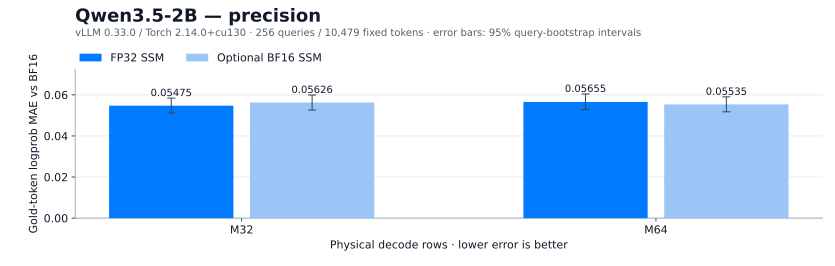
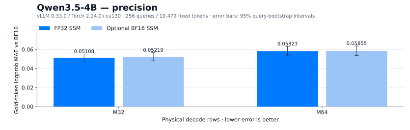
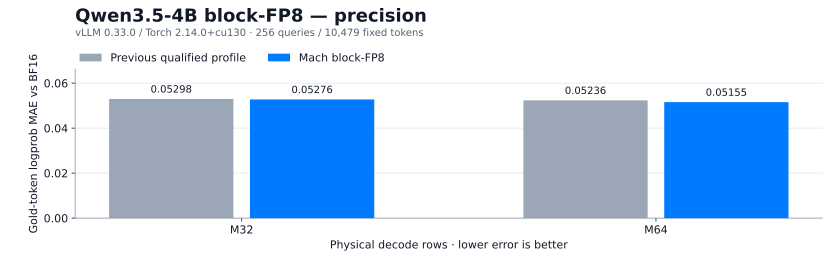
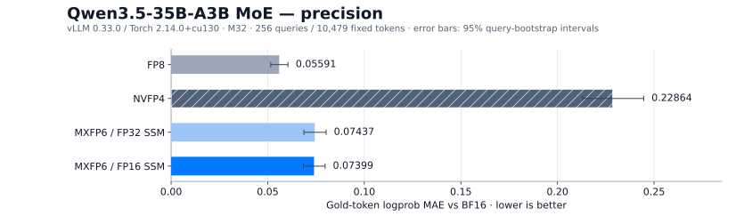

# Model serving performance

vLLM 0.33.0 / Torch 2.14.0+cu130

RTX 5090 · 3,000 input / 1,000 output tokens · output tokens/s.

FP32 recurrent state is the default. The tables identify optional state formats and the reference used for each comparison.

| Model / profile | GPUs | Measured concurrency |
|---|---:|---|
| [Qwen3.5-2B · MXFP8](performance.md#qwen35-2b) | 1 | c4, c16, c24, c32, c48, c64 |
| [Qwen3.5-4B · MXFP8](performance.md#qwen35-4b) | 1 | c4, c16, c24, c32, c48, c64 |
| [Qwen3.5-4B · block-FP8](performance.md#qwen35-4b-block-fp8) | 1 | c4, c16, c32, c64 |
| [Qwen3.8-27B Dense · MXFP6](performance.md#qwen38-27b) | 2 | c4, c16, c24, c32 |
| [Qwen3.5-35B-A3B MoE · MXFP6](performance.md#qwen35-35b-a3b) | 2 | c4, c16, c24, c32 |

## Qwen3.5-2B · MXFP8

MXFP8 / FP32 SSM default; BF16 SSM optional / BF16 KV / headgraph ON · TP1 · November 2026

| Concurrency | Community FP8 | MXFP8 FP32 (default) | MXFP8 BF16 (optional) | FP32 gain vs FP8 |
|---|---:|---:|---:|---:|
| c4 | 1240.06 | 1801.76 | 1884.69 | +45.30% |
| c16 | 3699.70 | 5070.80 | 5381.75 | +37.06% |
| c24 | 4926.73 | 6571.65 | 7018.89 | +33.39% |
| c32 | 5702.37 | 7544.90 | 8007.86 | +32.31% |
| c48 | 6732.99 | 8839.02 | 9395.60 | +31.28% |
| c64 | 7422.14 | 9721.13 | 10334.42 | +30.97% |

### Precision

[Setup and benchmark](https://github.com/troycheng/vllm-mach/blob/main/docs/mxfp8-2b-champion.md) · [Measurements](data/evidence-vllm033/two_b_fp32_default_composite.json) · [MXFP8 BF16 (optional) measurements](data/evidence-vllm033/two_b_bf16_final.json)

## Qwen3.5-4B · MXFP8

MXFP8 FP32 SSM / FP8 KV / hybrid head · TP1 · November 2026

| Concurrency | Community FP8 vLLM0.33 (BF16 KV) | MXFP8 FP32 SSM / FP8 KV | FP32 gain vs FP8 |
|---|---:|---:|---:|
| c4 | 688.28 | 956.35 | +38.95% |
| c16 | 2046.41 | 2684.51 | +31.18% |
| c24 | 2564.47 | 3384.25 | +31.97% |
| c32 | 2884.61 | 3820.60 | +32.45% |
| c48 | 3211.34 | 4297.35 | +33.82% |
| c64 | 3407.87 | 4796.72 | +40.75% |

### Precision

[Setup and benchmark](https://github.com/troycheng/vllm-mach/blob/main/docs/mxfp8-champion.md) · [Measurements](data/evidence-vllm033/four_fp32.json)

## Qwen3.5-4B · block-FP8

Block-FP8 / FP32 SSM / BF16 KV / full head / n64 + ordered + SiLU + FA2 · TP1 · November 2026

| Concurrency | Community FP8 | Mach block-FP8 | Mach gain vs FP8 |
|---|---:|---:|---:|
| c4 | 688.28 | 764.49 | +11.07% |
| c16 | 2046.41 | 2145.32 | +4.83% |
| c32 | 2884.61 | 3008.32 | +4.29% |
| c64 | 3407.87 | 3671.65 | +7.74% |

### Precision

Fixed-gold precision against BF16, averaged across 256 queries and 10,479 tokens at M32 and M64. The comparison uses the previously qualified block-FP8 profile. Repeated current-profile runs produced identical values.

| Decode rows | Previous qualified profile MAE | Mach MAE |
|---|---:|---:|
| M32 | 0.052977 | 0.052755 |
| M64 | 0.052362 | 0.051555 |

[Setup and benchmark](https://github.com/troycheng/vllm-mach/blob/main/docs/fp8-profile.md) · [Measurements](data/evidence-vllm033/block_fp8.json)

## Qwen3.8-27B Dense · MXFP6

MXFP6 / FP32 SSM or FP16 FULL / BF16 KV / head ON · TP2 · November 2026

| Concurrency | Community FP8 | Community NVFP4 | MXFP6 / FP32 SSM | MXFP6 / FP16 SSM | FP16 gain vs FP8 |
|---|---:|---:|---:|---:|---:|
| c4 | 271.47 | 366.88 | 418.37 | 427.43 | +57.45% |
| c16 | 798.18 | 1111.68 | 1121.78 | 1173.98 | +47.08% |
| c24 | 994.24 | 1363.64 | 1437.43 | 1506.69 | +51.54% |
| c32 | 1131.81 | 1531.52 | 1617.25 | 1727.78 | +52.66% |

### Precision

[Setup and benchmark](https://github.com/troycheng/vllm-mach/blob/main/docs/installation.md) · [Measurements](data/evidence-vllm033/dense_full.json) · [MXFP6 / FP32 SSM measurements](data/evidence-vllm033/dense_current.json)

## Qwen3.5-35B-A3B MoE · MXFP6

MXFP6 / FP32 SSM / BF16 KV / head ON / headgraph OFF · TP2 · November 2026

| Concurrency | Community FP8 | Community NVFP4 | MXFP6 / FP32 SSM | MXFP6 / FP16 SSM | FP32 gain vs FP8 |
|---|---:|---:|---:|---:|---:|
| c4 | 739.69 | 734.55 | 1196.01 | 1183.92 | +61.69% |
| c16 | 1647.34 | 1650.08 | 2474.88 | 2527.74 | +50.23% |
| c24 | 1956.68 | 1969.03 | 2901.03 | 3007.23 | +48.26% |
| c32 | 2186.13 | 2172.68 | 3257.79 | 3362.91 | +49.02% |

### Precision

[Setup and benchmark](https://github.com/troycheng/vllm-mach/blob/main/docs/qwen35-moe.md) · [Measurements](data/evidence-vllm033/moe_current.json) · [MXFP6 / FP16 SSM measurements](data/evidence-vllm033/moe_full_final.json)

## Measurement records

[Data and measurement protocol](data/evidence-vllm033/README.md) · [Normalized data](data/model-performance-vllm033.json) · [vLLM 0.29 → 0.33 comparison](data/evidence-vllm033/migration-status.json)

[Historical vLLM 0.29 FP8/NVFP4 comparisons](https://github.com/troycheng/vllm-mach/blob/main/docs/performance-vllm029.md)
