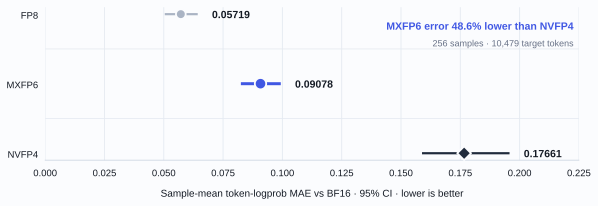
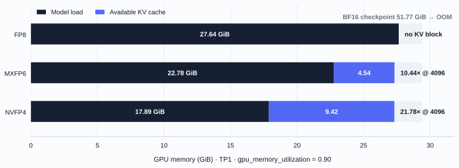

# Qwen3.8-27B quantization fidelity and capacity

This RTX 5090 snapshot compares official FP8, native MXFP6 W6A8 and NVFP4 W4A4 against the public BF16 model. MXFP6 and NVFP4 quantize the same 400 matrices and retain a BF16 lm_head. The [current Mach performance report](performance.md#qwen38-27b) contains the serving throughput comparison.

## BF16 token-logprob fidelity

The fidelity set contains 256 teacher-forced records: 64 each from GSM8K,
HumanEval, HellaSwag and CMMLU, for 10,479 target tokens. Metrics first average
target-token errors within each record and then weight all 256 records equally.

| Format | Sample-mean MAE vs BF16 | 95% CI | NLL absolute delta | Top-1 token agreement |
|---|---:|---:|---:|---:|
| FP8 | 0.05719 | [0.05042, 0.06431] | 0.02765 | 97.47% |
| MXFP6 | 0.09078 | [0.08250, 0.09932] | 0.03970 | 96.57% |
| NVFP4 | 0.17661 | [0.15886, 0.19576] | 0.07941 | 93.27% |

MXFP6's sample-mean MAE is 48.6% lower than NVFP4's, while FP8 remains
closest to BF16. The paired bootstrap interval for `NVFP4 MAE - MXFP6 MAE` is
[0.07356, 0.09945]. The ordering is also consistent in all four source domains:

| Domain | FP8 MAE | MXFP6 MAE | NVFP4 MAE | MXFP6 share of FP8→NVFP4 gap |
|---|---:|---:|---:|---:|
| Math | 0.05334 | 0.10443 | 0.18021 | 40.3% |
| Code | 0.01888 | 0.03326 | 0.06797 | 29.3% |
| English | 0.12556 | 0.16689 | 0.35671 | 17.9% |
| Chinese | 0.03095 | 0.05852 | 0.10155 | 39.1% |

## Memory and KV capacity

The recorded TP2 runs report model load and KV-cache capacity:

| Format | Model load GiB/GPU | Available KV GiB/GPU | GPU KV-cache tokens | 4096-token concurrency |
|---|---:|---:|---:|---:|
| FP8 | 14.09 | 12.46 | 236,658 | 57.78× |
| MXFP6 | 11.46 | 14.99 | 284,899 | 69.56× |
| NVFP4 | 9.05 | 17.47 | 332,003 | 81.06× |

The capacity fields are means from two fresh service lifecycles. The runtime reported a 2,731-token range for FP8, 6,372 for MXFP6
and 2,276 for NVFP4 across the paired starts.

The TP1 fit check uses one GPU. At max model
length 4096, 4096 maximum batched tokens, 64 maximum sequences and
`gpu_memory_utilization=0.90`, BF16 ran out of memory and FP8 left no KV block.
MXFP6 started with 4.54 GiB of KV cache and NVFP4 with 9.42 GiB:

| Format | Checkpoint GiB | Model load GiB | Available KV GiB | 4096-token concurrency | Result |
|---|---:|---:|---:|---:|---|
| BF16 | 51.77 | — | — | — | failed |
| FP8 | 28.77 | 27.64 | -0.31 | — | failed |
| MXFP6 | 24.16 | 22.78 | 4.54 | 10.44× | ready |
| NVFP4 | 19.20 | 17.89 | 9.42 | 21.78× | ready |

FP8's result means that this shared 90% memory contract left no KV block. It
does not establish that FP8 fails under every possible memory setting.

## Sources

Capacity uses the frozen vLLM 0.25.1 runtime with a 90% memory budget; TP2 values are means of two fresh lifecycles. The artifact records runtime identity and the exact limits. Token-logprob fidelity measures approximation to BF16 rather than task accuracy.

- [Fidelity](../benchmarks/results/qwen38_27b_quality_fidelity.json)
- [TP2 capacity and service metadata](../benchmarks/results/qwen38_27b_concurrency_tp2.json)
- [TP1 capacity](../benchmarks/results/qwen38_27b_capacity_tp1.json)
- [Environment](../benchmarks/results/qwen38_27b_environment.json)

The retained figures are generated by [plot_qwen38_snapshot.py](../benchmarks/plot_qwen38_snapshot.py).
